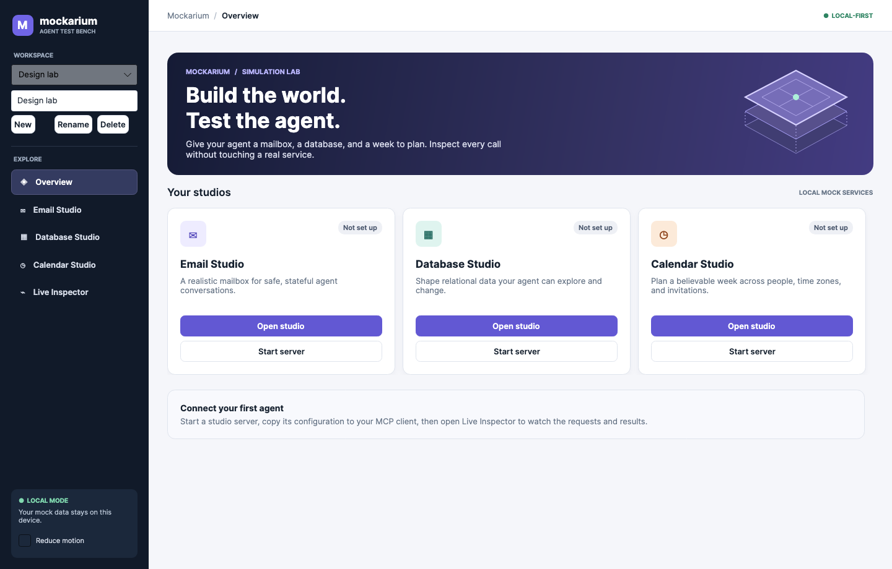

# Mockarium

**Build the world. Test the agent.**

Mockarium is a local-first desktop application for testing AI agents against simulated MCP services. It provides realistic Email, Database, and Calendar workspaces and shows the real tool calls agents make; it is not an AI agent builder.



## Desktop applications

The application targets **.NET 11 only**:

- **Windows:** native WPF client.
- **macOS and Linux:** Avalonia client.

Both clients use the same MVVM layer, domain services, SQLite store, and MCP runtime. MCP listeners bind to loopback; the simulated services do not connect to real email, calendars, or databases.

## Run from source

Install the .NET 11 SDK. Open [Mockarium.slnx](Mockarium.slnx) in your IDE,
or run the following commands from the repository root.

On macOS and Linux, run the Avalonia client:

```sh
dotnet run --project src/Mockarium.Desktop
```

On Windows, run the WPF client:

```powershell
dotnet run --project src/Mockarium.Wpf
```

## First workspace

Enter a name on the overview and press **Enter** to create your workspace.
Open a studio to edit its starter data, or choose **Start server** to create
the starter data and start listening in one step. Copy the configuration to
your MCP client, then use **Live Inspector** to see its requests and results.
Nothing connects to a real service. A **Reduce motion** preference is
available in the sidebar.

## Release builds

The GitHub release workflow is configured to create self-contained application
archives for Windows x64 (WPF), macOS arm64 and x64 (Avalonia), and Linux x64
and arm64 (Avalonia). These archives include the .NET runtime; they are not
installers. The macOS archives contain a `Mockarium.app` bundle with an icon.
The workflow has not yet been validated through an actual release. macOS
bundles are not signed or notarized for distribution, so Gatekeeper may block
launch. Native installers and release validation on each operating system
remain future work.

Run tests and build both clients:

```sh
dotnet build -c Release
dotnet test -c Release --no-build
```

## Studios

### Email Studio

Customize mailbox identity, messages, folders, and contacts. Simulated send,
reply, and draft tools never contact a real email provider.

### Database Studio

Edit a relational model and sample records. The MCP tools expose validated
record operations, not raw SQL. Save model changes before starting or stopping
the database server.

### Calendar Studio

Plan a week with draggable events, people in different time zones, working
hours, invitations, and a simulated clock. No real invitations are sent.

## Data and migration

The .NET application stores its SQLite database under
`Environment.SpecialFolder.ApplicationData/mockarium/mockarium.sqlite`. If only
an existing database in the alternate `Mockarium` directory is found, the app
reuses it. If both directories contain different databases on a case-sensitive
filesystem, startup stops rather than silently selecting one: back up both and
move the unwanted database elsewhere before restarting. Close all Mockarium
instances before backing up or moving the database, and include any associated
`-wal` and `-shm` files. A compatibility test opens a database generated by the
Electron store and verifies data from all three studios and execution history.
Exact packaged Electron user-data paths have not yet been verified on every OS,
so back up an existing database before the first .NET launch.

## Repository layout

The desktop clients and shared libraries are in [src](src); the integration
and headless UI tests are in [tests](tests). The solution builds and runs
without a JavaScript toolchain.

See [docs/ARCHITECTURE.md](docs/ARCHITECTURE.md),
[docs/PRODUCT.md](docs/PRODUCT.md), and [docs/ROADMAP.md](docs/ROADMAP.md).
Contributor instructions are in [CONTRIBUTING.md](CONTRIBUTING.md).
